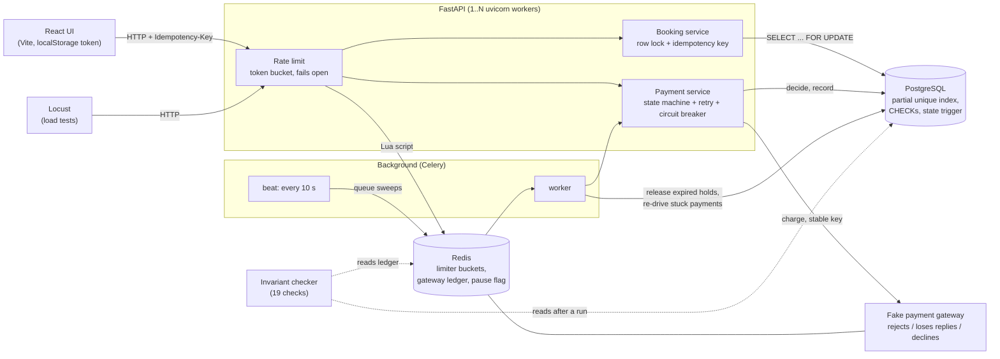
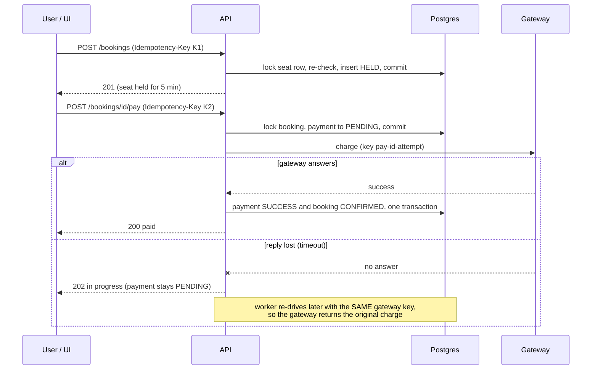

# Tatkal-Rush

A high-concurrency, IRCTC Tatkal-style train booking backend. Thousands of users
try to book the same seats at once, and the system must never double-book a seat
or double-charge a payment.

> Status: **all 8 phases complete** (schema, auth, booking with row locks and
> idempotency, payments with a state machine, fake gateway and circuit breaker,
> background worker for hold expiry and stuck payments, Redis rate limiter, React
> UI, load tests with an invariant checker, GitHub Actions workflow).
> CI: the first GitHub Actions run (2026-10-14, commit a4f0371) passed all three jobs (see "CI").

## What this project demonstrates
- **Correctness under concurrency**: 200 simultaneous requests for one seat produce exactly one
  booking; 50 simultaneous payment requests for one booking produce exactly one charge.
- **Safe retries**: every mutating request carries an idempotency key, so a retry after a timeout,
  a double-click or a lost response can never book or charge twice.
- **Failure handling**: a payment gateway that rejects, declines and loses replies, handled with a
  payment state machine, retries with backoff, a circuit breaker and a background re-drive.
- **Evidence, not claims**: 246 backend tests on real Postgres, 67 frontend tests, and load runs of
  1,000 simultaneous users judged by an independent checker of 19 invariants (209 of 209 passed
  across 11 runs). Every number below comes from a run you can repeat with the command shown.

## Architecture



One booking and payment, including the case where the gateway's reply is lost:



Why the pieces are shaped this way is explained under "Design decisions".

## Stack
Python 3.12, FastAPI, PostgreSQL 16, Redis 7, Celery 5.6, SQLAlchemy 2, Alembic,
React + Vite, Locust, Docker Compose, GitHub Actions.

## Quick start
```bash
docker compose up -d --build
curl http://localhost:8000/health
docker compose exec api python -m app.seed
docker compose exec api python -m pytest -q -p no:warnings
```
Interactive API docs: http://localhost:8000/docs

Load test (Git Bash, API stack running; see "Load tests" below):
```bash
loadtest/run_scenario.sh 100x 1000 200 180 off 1     # 1,000 users, 40 seats, 1 API worker
```

The UI (Node required, API stack running):
```bash
cd frontend && npm install && npm run dev      # then open http://127.0.0.1:5173
```

## API
| Method | Path | Notes |
|---|---|---|
| POST | `/auth/register` | email + password (8-72 bytes) |
| POST | `/auth/login` | returns a JWT (60 min) |
| GET | `/trains` | search by `source` / `destination` (case-insensitive contains) |
| GET | `/trains/{id}/schedules` | upcoming dates with fare and seats still available |
| GET | `/schedules/{id}/seats` | seat map: AVAILABLE / HELD / BOOKED |
| POST | `/bookings` | `Authorization: Bearer <jwt>` + `Idempotency-Key`. 201 created, 200 replay, 409 seat taken, 422 key reused for a different seat |
| GET | `/bookings` | the caller's recent bookings with seat, train and payment status |
| GET | `/bookings/{id}` | owner only |
| POST | `/bookings/{id}/pay` | `Idempotency-Key` required. 200 paid, 402 attempt failed (retry with a new key), 202 in progress/unresolved, 409 not payable or key already used |
| GET | `/bookings/{id}/payment` | owner only |
| GET | `/health` | Postgres, Redis, and the payment and rate-limiter circuit states |

## Repository layout
```
backend/app/            FastAPI app: routers/, services/ (booking, payment, expiry), gateway, circuit breaker,
                        rate limiter, worker/ (Celery)
backend/alembic/        migrations (0001 schema, 0002 payment state trigger, 0003 sweep indexes)
backend/tests/          246 tests, all against real Postgres and Redis
backend/tools/          load-test provisioning, cleanup, invariant checker, results summary
frontend/               React + Vite UI and its 67 tests
loadtest/               Locust scenario and run_scenario.sh
.github/workflows/      CI
docker-compose.yml      postgres, redis, api, worker, beat (+ locust on demand)
```

## Data model
`users`, `trains`, `schedules` (one train on one date), `seats` (per schedule),
`bookings`, `payments`. Money is stored as integer paise.

## Design decisions

### Booking: three layers stop a double booking
1. **Row lock.** A booking first runs `SELECT ... FOR UPDATE` on the seat row.
   Competing requests for that seat queue behind it instead of racing.
2. **Re-check under the lock.** Once a request gets the lock it re-reads the
   seat's bookings. The previous holder has committed, so the loser sees the
   winner and gets HTTP 409.
3. **Database backstop.** A partial unique index on `bookings(seat_id)` covering
   only `HELD`/`CONFIRMED` rows means Postgres itself refuses a second active
   booking even if layers 1 and 2 had a bug. Expired and cancelled rows are
   excluded, so a freed seat can be rebooked without deleting history.

*Why a row lock and not just the index?* The index alone is correct, but every
loser would fail at insert time and need error handling; with the lock the
common case is a clean "seat taken". *Why not just the lock?* A lock only
protects code paths that remember to take it; the index protects the data.

This relies on PostgreSQL's default READ COMMITTED isolation: after the lock is
acquired, the next query sees what the previous holder committed. Under
REPEATABLE READ this design would need serialization-failure retries.

### Booking idempotency
- `UNIQUE(user_id, idempotency_key)` on bookings; the key is scoped per user.
- Retries look the key up without a lock (fast path), and re-check after taking
  the seat lock, because two identical concurrent requests can both pass the
  fast path.
- A replay returns the original booking with HTTP 200 and `Idempotent-Replay:
  true`. The same key with a different seat is a client bug and returns 422.

### Expired holds are released inside the booking path
Booking treats a `HELD` row past its expiry as free and marks it `EXPIRED` under
the seat lock. Correctness therefore never depends on the background worker
(Phase 4) having run on time; the worker only tidies up. **Exception:** a hold
with a `PENDING` payment is never released, because money may be moving.

### Payments: never twice, never without a seat, never lose track
`pay_booking` is deliberately three short steps instead of one long transaction:

1. **Decide** (under the booking row lock): replay a stored result, or move the
   payment to `PENDING` and *commit*. Concurrent requests for the same booking
   queue on the lock, then see `PENDING`, so only one of them reaches the gateway.
2. **Charge** (no transaction open, so no DB connection is held while waiting on
   a slow gateway): call the gateway with a stable idempotency key
   `pay-<payment id>-<attempt>`, through retries with exponential backoff and a
   circuit breaker.
3. **Record** (booking lock, then payment lock): success marks the payment
   `SUCCESS` and the booking `CONFIRMED` atomically; a definite failure marks it
   `FAILED` and leaves the seat held so the user can retry.

**A timeout is ambiguous, so it is never recorded as FAILED.** The gateway may
have charged and lost its response. The payment stays `PENDING`; once it is
stale (30 s) the next request re-drives it with the *same* gateway key, and the
gateway returns the original charge instead of charging again. Marking it FAILED
would risk "charged but recorded as failed", which is exactly an orphan payment.

**Retry rules.** Only transient errors are retried (rejected-before-processing and
timeouts), with exponential backoff and full jitter so a crowd of clients does not
retry in lockstep. A card decline is final and never retried.

**Circuit breaker.** After 5 consecutive gateway failures the circuit opens and
calls fail instantly without touching the gateway; after 10 s one probe call is
let through (half-open) to test recovery. A decline does not count as a failure:
it is a normal answer from a healthy gateway. State is per process (thread-safe);
sharing it through Redis would make all API workers trip together at the cost of
an extra round trip per call.

**State machine, enforced twice.** `CREATED -> PENDING -> SUCCESS | FAILED`, and
`FAILED -> PENDING` for a user retry. Python checks it, and so does a Postgres
trigger, so a bug (or a manual UPDATE) cannot move a payment backwards such as
`SUCCESS -> FAILED`.

**Lock order is always seat -> booking -> payment**, never reversed, so these
paths cannot deadlock each other.

### The React UI: retries must be safe by construction
Three screens in one page: search trains and pick a date, a seat map (colour-coded, refreshing
every 3 s), and a booking panel with a live hold countdown and the pay button. Plain JavaScript,
React and Vite only. The interesting part is how it behaves when things go wrong:

- **The UI chooses the idempotency key, per attempt.** It keeps the same key while the outcome is
  unknown (the connection dropped, a 429, a 5xx, a payment still in progress), so pressing the button
  again re-sends the *same* request and the server returns the original result instead of booking or
  charging twice. It makes a new key once the server has given a final answer (success, "seat taken"),
  and after a declined payment, because a decline is final and the next try is a new attempt.
- **A payment in progress is never shown as expired or failed.** A hold whose payment is still
  pending is not released by the server either, so the panel says "payment in progress" and polls until
  it settles. A declined or unavailable payment says "you were not charged".
- **A flaky connection is not an emergency.** A failed background refresh shows a small note on the seat
  map that clears itself when the connection returns; it does not leave an error banner behind.
- **Login in `localStorage`.** It survives a refresh, and every access is guarded because storage can be
  blocked. The trade-off: any script on the page could read it, so an XSS bug would leak the token. React
  escapes rendered text and the token expires after 60 minutes; a production app would use an httpOnly
  cookie instead.
- **CORS** allows only the Vite dev origin, lists the custom request headers explicitly
  (`Idempotency-Key` is not a default-allowed header) and exposes the response headers the UI reads
  (`Retry-After`, `Idempotent-Replay`). Unhandled 500s carry no CORS headers, so a browser reports them as a
  network error.
- The seat map and date list use the same rules as booking, so an overdue hold with a payment in flight
  shows as held rather than offering a seat that would be refused.

### Rate limiting: a token bucket that fails open
Every request costs one token from a bucket that holds 10 and refills at 5 per
second, so a person never notices it but a bot firing hundreds of requests a second
is refused with `429` and a `Retry-After` header. The bucket belongs to the logged-in
user (from the JWT) or, when not logged in, to the client IP. A larger per-IP ceiling
(100 burst, 50 per second) sits on top, so one address cannot dodge the limit by
creating many accounts.

- **Why a Lua script.** Refilling, taking a token and writing back must be one
  indivisible step. As separate Redis commands, simultaneous requests all read the
  same token count and all get in; Redis runs a Lua script without interleaving
  anything, so the step is atomic. The script also reads the time from Redis itself,
  so every API process shares one clock. A test shows the difference: 500
  simultaneous requests on a 10-token bucket admit exactly 10, while a naive
  read-modify-write version let through far more (it admitted all 200 in four of five
  measured rounds).
- **Why a bucket and not "N per minute".** It permits short bursts yet caps the
  sustained rate, with no hard reset at a window boundary to exploit.
- **Fail open.** If Redis is unreachable the limiter lets requests through. The
  database already guarantees correctness (no double booking, no double charge); the
  limiter only protects capacity, and refusing every request because the limiter's
  own store is down would turn a small outage into a total one. A circuit breaker
  stops each request waiting on the dead connection. The trade-off is that a bot
  gets through during a Redis outage.
- **Cheap and safe.** It verifies the JWT signature but never touches the database,
  so it cannot hold a connection (see the 503 section below). A forged or expired
  token cannot choose its own bucket: it falls back to the IP. `X-Forwarded-For` is
  ignored unless explicitly trusted, because clients can spoof it.
- **Ops switch.** A Redis flag with a TTL turns limiting off, e.g. for correctness
  load tests run from a single machine, which a per-IP limit would otherwise throttle.
- Limits: anonymous users behind one NAT share a bucket, and the per-IP ceiling can
  block legitimate users on a shared address.

### Background worker: housekeeping that can never cause a wrong answer
Celery beat queues two sweeps every 10 s; workers run them. They are idempotent,
so at-least-once delivery (`acks_late`) is safe, and a stale queued sweep is
dropped (`expires`) instead of piling up behind a dead worker.

- **Hold expiry** only tidies up: booking already treats an overdue hold as free.
  It uses `FOR UPDATE SKIP LOCKED`, so two sweepers (or a sweeper and a live
  booking or payment) never block each other or release the same hold twice.
  It **never releases a hold whose payment is PENDING**, checked in the query and
  again after the row lock, because the first check ran on an older snapshot.
- **Payment re-drive** finishes payments stuck in PENDING (a timeout whose
  outcome was unknown). It goes through the same `pay_booking` code as a user
  retry: it *claims* the payment first, so concurrent workers do not pile on, and
  it reuses the original gateway key, so the gateway returns the original charge
  instead of charging again.
- **Retries:** transient database or Redis errors retry 3 times with exponential
  backoff and jitter; a failure on one payment never stops the rest of the batch.
- **Kill switch:** a Redis flag with a TTL pauses both sweeps (for incidents; the
  test suite uses it so a live worker cannot touch data the tests count exactly).
- Limits: an unresolved payment keeps its seat held until it resolves. There is
  no refund or escalation flow, only a log warning after 10 minutes.

### Overload returns 503, not a hang (and a connection is never held while waiting for a thread)
FastAPI runs synchronous endpoints on a 40-thread pool and hops back onto it to build
the response. If a request still holds a database connection at that moment, it holds a
connection while waiting for a thread; under load every thread ends up waiting for a
connection that belongs to a request waiting for a thread, and the system stalls until a
timeout breaks the cycle. **This bit twice**, both times found by load, not by reading code:

- Phase 2: 200 simultaneous requests hung for 60 s and returned 500s. The auth dependency
  kept its transaction open. Fix: commit right after loading the user.
- Phase 7: at 1,000 users every read endpoint (seat map, search, my bookings...) left its
  transaction open until after the response was built. Postgres showed **exactly 40
  connections "idle in transaction" and every container's CPU near zero**: the API was not
  busy, it was stuck (85% of requests timed out, 8 of 40 seats sold). Fix: **every endpoint
  ends its transaction before it returns**, and the rule is enforced by a regression test
  (`tests/test_no_deadlock.py`) that shrinks both pools to 2 so the stall appears at once.
  Undoing the fix in any one read endpoint makes that test fail.

Two smaller findings from the same investigation: `rollback()` expires every loaded object,
so a replayed booking or payment was being re-queried while the response was built (replays
now `commit()`), and a column the database fills in on UPDATE (`updated_at`) is left
unloaded, so it is now set explicitly. And the API's pool is `workers x (pool + overflow)`
connections: with 4 workers that was 160 against Postgres' default limit of 100, which
answered `FATAL: too many clients` and became 472 HTTP 500s. Postgres now allows 200 and the
pool sizes are configurable (`DB_POOL_SIZE`, `DB_MAX_OVERFLOW`).

If a connection still cannot be obtained (pool timeout, "too many clients", a dropped
connection) the API answers `503` with `Retry-After`, and the idempotency key makes retrying
safe. The dependency that opens the session (`get_db`) is an async generator so its cleanup
runs on the event loop; that was added on a hypothesis and **no test shows it is necessary**
(the stall does not return when it is a plain generator again), so it is defence in depth for
error paths, not the fix.

### Tests run on real Postgres
Partial indexes, CHECK constraints, triggers and row locks behave differently on
SQLite.

## Testing (what is verified, and how)
Run everything: `docker compose exec api python -m pytest -q -p no:warnings`

| Claim | Test |
|---|---|
| 200 parallel requests for 1 seat -> exactly 1 success (service level) | `test_concurrency.py::test_200_parallel_bookings_for_one_seat_give_exactly_one_success` |
| Same through the live HTTP API -> one 201, 199 x 409 | `test_concurrency.py::test_200_parallel_http_requests_for_one_seat_give_exactly_one_201` |
| 200 users over 20 seats -> each seat booked exactly once | `test_concurrency.py::test_200_users_across_20_seats_book_each_seat_exactly_once` |
| 50 parallel retries with one key -> one booking | `test_concurrency.py::test_50_parallel_retries_with_the_same_key_create_one_booking` |
| The booking service really takes the row lock | `test_concurrency.py::test_booking_really_waits_on_the_seat_row_lock` |
| The DB index alone stops double booking | `test_concurrency.py::test_database_index_alone_stops_double_booking` |
| 40 seats with expired holds, 3 bookers each + 4 sweepers at once -> one new booker per seat | `test_worker_concurrency.py::test_sweepers_and_new_bookers_race_over_expired_holds` |
| 4 parallel sweepers over 100 expired holds -> each released exactly once | `test_worker_concurrency.py::test_parallel_sweepers_release_each_hold_exactly_once` |
| A hold expiring while its payment is in flight is never released | `test_worker_concurrency.py::test_a_sweeper_never_releases_a_hold_while_its_payment_is_in_flight` |
| A sweeper skips locked rows instead of waiting | `test_worker_concurrency.py::test_a_sweeper_skips_a_locked_booking_instead_of_waiting` |
| 4 parallel re-drive workers charge each stuck payment exactly once | `test_worker_concurrency.py::test_parallel_redrive_workers_charge_each_stale_payment_exactly_once` |
| 500 simultaneous requests on a 10-token bucket -> exactly 10 allowed | `test_ratelimit_concurrency.py::test_500_simultaneous_requests_get_exactly_capacity_tokens` |
| 200 requests over 20 identities -> exactly 5 each | `test_ratelimit_concurrency.py::test_200_requests_over_20_identities_get_exactly_capacity_each` |
| A naive non-atomic limiter over-admits (why Lua) | `test_ratelimit_concurrency.py::test_a_naive_read_modify_write_limiter_lets_extra_requests_through` |
| Bucket maths, fail open, per-user and per-IP behaviour over HTTP | `test_ratelimit.py` |
| The invariant checker detects 21 kinds of corruption (double booking, orphan payment, double charge, ...) | `test_invariants.py` |
| Read endpoints never stall when threads and connections run out (pools shrunk to 2) | `test_no_deadlock.py` |
| 50 parallel pay requests for one booking -> exactly 1 gateway charge | `test_payment_concurrency.py::test_50_parallel_payments_for_one_booking_charge_exactly_once` |
| ...even when each retry uses a different key | `test_payment_concurrency.py::test_50_parallel_payments_with_different_keys_still_charge_once` |
| Under chaos: no double charge, no FAILED-but-charged, no orphans | `test_payment_concurrency.py::test_chaos_never_double_charges_and_leaves_no_orphans` |
| All 12 status transitions: 4 legal pass, 8 illegal rejected, by Python and by the DB trigger | `test_state_machine.py` |
| Breaker opens / half-opens / closes; backoff doubles and caps | `test_resilience.py` |

**Frontend.** `cd frontend && npm test` runs 67 tests (Vitest + Testing Library) over the API client,
helpers, `localStorage` handling and the Search, SeatMap and BookingPanel components. They check behaviour,
not just rendering: which idempotency key goes out on each retry, the pay flow's states (paid, declined, in
progress, expired), and what happens when storage or the network fails. The app was also driven for real in a
browser: register, log in, reload, book, pay, a declined card then a successful retry, and an API restart under
an open seat map. That run found two bugs the unit tests had missed (a "no dates" message that flashed while
loading, and an error banner that stayed after the server recovered); both now have tests.
Not verified: how it looks (screenshots were not possible), other browsers, mobile layout, screen readers.

The chaos test runs 60 bookings, each paid by 3 simultaneous duplicate requests,
against a gateway that rejects 20% of calls, loses 60% of responses (including on
retries) and declines 5%. It audits the database against the gateway's own ledger
(its "bank statement") and then re-drives the unresolved payments.

**Mutation checks.** To confirm the tests can actually fail, the code was broken
on purpose (6 ways in the payment code, 7 in the worker code, 10 in the rate limiter, 11 in the UI logic, and by undoing each deadlock fix in turn) (no booking lock when starting a payment, unstable
gateway key, timeout recorded as FAILED, hold released while a payment is in
flight, declines tripping the circuit, success not confirming the booking) and
the suite failed every time. One known gap: removing only the re-check after the
sweeper's row lock is not detected, because it guards a window of a few
milliseconds that cannot be forced. One run found the chaos test was initially
vacuous (the fake gateway never lost a response on a retry, so no payment ever
stayed unresolved); that was fixed, and the test now asserts that payments really do stay unresolved.

Limits of these tests: "N parallel" means N requests released at the same
instant; database concurrency is bounded by the connection pool (50 for the
service tests, 20 + 20 overflow for the API). They run against a single API
process and a single worker with zero gateway latency; multi-worker behaviour is
covered by the load tests below, not by this suite.

## CI (GitHub Actions)
`.github/workflows/ci.yml` runs on every push and pull request, as three independent jobs:

| Job | What it does |
|---|---|
| `backend` | `docker compose up --build --wait`, then `pytest` inside the api container (246 tests), then `alembic check` (models and migrations agree) |
| `frontend` | Node 20, `npm ci`, `npm test` (67 tests), `npm run build` |
| `load-smoke` | `loadtest/run_scenario.sh ci-smoke 20 10 120 off 1 10 1`: 20 users, 10 seats, judged by the 19 invariant checks; fails the job if any fails; uploads the reports |

The backend tests run inside the compose stack rather than against bare service containers because some
of them (`test_concurrency.py`) talk to a live API and skip themselves without one.

The 1,000-user scenarios are **not** in CI: they take minutes, need many CPUs and shared runners are too
noisy to give numbers worth recording. The smoke job checks that the whole pipeline (stack, load
generator, checker) still works, not performance.

**What was verified, and what was not.** Before pushing I could not run GitHub Actions, so: the workflow passes
`actionlint`, and each job's commands were run locally against a freshly created (empty) database
volume: 246 backend tests passed, `alembic check` was clean, the smoke scenario passed 19/19, and the
frontend's `npm ci`, tests (67) and build succeeded in a clean copy. Differences that only a real
run can reveal: the runner's Node (locally 24, CI pins 20), its Docker and Compose versions, and timing
on a slower machine.

**First real run:** the first push to GitHub passed all three jobs (backend 1m 15s, frontend 21s,
load-smoke 2m 21s; 2m 25s in total). That was read from the run's summary page; the job logs and the
run's 3 warnings and 3 notices were not inspected.

## Load tests and the invariant checker

**What is simulated.** A Tatkal rush: simulated users (Locust, in a container on the same Docker
network) try to book a handful of seats at the same instant, then pay through the random
gateway (30% of calls rejected, 10% charge but lose the response, 5% declined). Each user
behaves like the real UI: every request carries an idempotency key, an unknown outcome
(timeout, 5xx, 429) is retried with the **same** key, a declined payment is a new attempt with
a **new** key after a 1-3 s pause, and about 10% of requests are sent **twice at once**
(a double-click). Locust's own "failures" mean real faults only; an expected 409 (seat taken),
402 (declined) or 429 (rate limited) is not a failure.

- **1x** = 10 users, each making 20 bookings in a row on 400 seats (little contention: a
  sustained baseline; at one booking each the run lasts 5 s, too short to measure).
- **100x** = 1,000 users, one booking each, rushing **40 seats** (about 25 users per seat).

**How it is judged.** Not by "no errors". After every run `tools/check_invariants.py` reads
the database and the payment gateway's own ledger (its "bank statement") and checks 19
promises, then compares them with what each simulated user was told. Among them: no seat has
more than one active booking; every CONFIRMED booking has exactly one SUCCESS payment and
every SUCCESS payment belongs to a CONFIRMED booking (zero orphans); no payment is charged
more than once; no FAILED payment was ever charged; every charge on the ledger belongs to a
payment and the money charged equals the money of SUCCESS payments; no payment is left
unresolved once the background worker has had its turn; every "confirmed" a user was told is
a CONFIRMED booking. The checker itself is tested by feeding it 21 kinds of deliberately
corrupted data and requiring it to notice each one (`tests/test_invariants.py`).

**Reproduce** (Git Bash on Windows; each command restarts the stack, provisions its own train and
users, runs, checks, and cleans up; run files land in `loadtest/data/`):
```bash
loadtest/run_scenario.sh 1x-a          10   10  180 off 1 400 20   # NAME USERS SPAWN_RATE MAX_S LIMITER WORKERS SEATS ROUNDS
loadtest/run_scenario.sh 100x-a        1000 200 180 off 1          # 1 API worker, rate limiter bypassed
loadtest/run_scenario.sh 100x-4w-a     1000 200 180 off 4          # 4 API workers
loadtest/run_scenario.sh 100x-limited-a 1000 200 180 on  1         # rate limiter active
docker compose exec api python -m tools.summarize_runs             # the tables below
```
The scenarios use a 20 s hold (so seats recycle during the run) and a 10 s "stale payment"
threshold; both are set by the script.

### Results (measured 2026-10-14; each scenario run three times because the gateway is random)

Machine: Intel i5-12500H laptop (12 cores / 16 threads, 15.6 GB), Docker Desktop VM with 16 CPUs
and 7.6 GB. **The load generator, API, Postgres and Redis all share it**, so these are
laptop numbers, not capacity claims. `429s` counts limiter refusals. Latencies include
Locust's own client-side queueing.

| run | users | API workers | limiter | seats sold | requests | failed | req/s | median | p95 | p99 | 429s | invariants |
|---|---|---|---|---|---|---|---|---|---|---|---|---|
| 1x-a | 10 | 1 | off | 186 / 400 | 608 | 0 | 29 | 29 ms | 170 ms | 360 ms | 0 | 19/19 |
| 1x-b | 10 | 1 | off | 122 / 400 | 774 | 0 | 15 | 30 ms | 120 ms | 230 ms | 0 | 19/19 |
| 1x-c | 10 | 1 | off | 190 / 400 | 602 | 0 | 23 | 40 ms | 170 ms | 340 ms | 0 | 19/19 |
| 100x-a | 1000 | 1 | off | 40 / 40 | 5921 | 5 | 120 | 6.2 s | 12.0 s | 15.0 s | 0 | 19/19 |
| 100x-b | 1000 | 1 | off | 40 / 40 | 8926 | 6 | 121 | 6.6 s | 11.0 s | 16.0 s | 0 | 19/19 |
| 100x-c | 1000 | 1 | off | 40 / 40 | 6547 | 6 | 134 | 3.0 s | 11.0 s | 15.0 s | 0 | 19/19 |
| 100x-4w-a | 1000 | 4 | off | 40 / 40 | 12799 | 7 | 261 | 13 ms | 1.5 s | 2.2 s | 0 | 19/19 |
| 100x-4w-b | 1000 | 4 | off | 40 / 40 | 12733 | 4 | 261 | 14 ms | 2.1 s | 3.2 s | 0 | 19/19 |
| 100x-4w-c | 1000 | 4 | off | 40 / 40 | 12727 | 3 | 262 | 13 ms | 2.0 s | 3.0 s | 0 | 19/19 |
| 100x-limited-a | 1000 | 1 | on | 40 / 40 | 9062 | 1 | 182 | 39 ms | 2.5 s | 5.3 s | 6582 | 19/19 |
| 100x-limited-b | 1000 | 1 | on | 40 / 40 | 9165 | 5 | 185 | 38 ms | 2.5 s | 5.4 s | 6669 | 19/19 |

What the users went through, and what the system did about it:

| run | users told confirmed | sold out | gave up on payment | double-clicks sent | same-key retries | gateway calls | real charges | payments failed (reason) |
|---|---|---|---|---|---|---|---|---|
| 1x-a | 186 | 0 | 14 | 30 booking / 31 payment | 0 / 0 | 292 | 186 | gateway_unavailable: 14 |
| 1x-b | 122 | 0 | 78 | 20 booking / 56 payment | 0 / 0 | 211 | 122 | gateway_unavailable: 77, declined: 1 |
| 1x-c | 190 | 0 | 10 | 28 booking / 21 payment | 0 / 0 | 313 | 190 | gateway_unavailable: 9, retries_exhausted: 1 |
| 100x-a | 40 | 941 | 0 | 189 booking / 8 payment | 0 / 0 | 63 | 40 | gateway_unavailable: 18, declined: 1 |
| 100x-b | 40 | 935 | 0 | 375 booking / 11 payment | 0 / 0 | 72 | 40 | gateway_unavailable: 19, declined: 6 |
| 100x-c | 40 | 960 | 0 | 102 booking / 3 payment | 0 / 0 | 62 | 40 | none |
| 100x-4w-a | 40 | 960 | 0 | 106 booking / 3 payment | 0 / 0 | 80 | 40 | none |
| 100x-4w-b | 40 | 960 | 0 | 109 booking / 4 payment | 0 / 0 | 67 | 40 | none |
| 100x-4w-c | 40 | 960 | 0 | 125 booking / 2 payment | 0 / 0 | 64 | 40 | none |
| 100x-limited-a | 40 | 500 | 10 | 101 booking / 9 payment | 3414 booking / 99 payment | 61 | 40 | declined: 2 |
| 100x-limited-b | 39 | 511 | 5 | 109 booking / 6 payment | 3462 booking / 59 payment | 69 | 40 | none |

Peak CPU while loaded (100% = one core): 100x on one worker, API **129-150%** (saturated),
Postgres 26-30%, Locust 77-84%; 100x on four workers, API **531-569%**, Postgres 66-82%, Locust
77-80%; the background worker and beat stayed under 5%.

**What this shows**
- **Safety held everywhere.** 11 runs x 19 checks = 209 checks, 0 failures; 1,448 double-click
  duplicates were sent across the runs and none produced a second booking or charge; zero HTTP
  5xx responses in any run. Every user told "confirmed" had a CONFIRMED booking, and the money
  on the gateway's ledger always equalled the payments marked SUCCESS.
- **100x on one worker is saturated, not broken.** All 40 seats sell, but the single API
  process is at its limit (about 120-134 req/s, the process pegged at 129-150% of a core) and a
  request queues for seconds (median 3.0-6.6 s, p95 11-12 s). Between 55% and 82% of the requests
  are users refreshing the seat map (about 90% with four workers, which can serve more refreshes). **Four workers roughly double throughput (261 req/s) and cut
  the median from seconds to 13 ms**, with all invariants intact: this is also the multi-worker
  run that had been listed as unverified. It is about 2x, not 4x, and I did not isolate why
  (Postgres at 66-82% of a core, the load generator at about 0.8 core and 40 hot rows are all
  candidates).
- **The rate limiter does its job and its cost is visible.** With everyone behind one IP, 73% of
  responses were 429s; the API stayed at about 115% CPU and the invariants held. It also throttled
  legitimate users: about 450 of the 1,000 gave up with a booking error after exhausting their
  retries. That is the shared-IP limitation noted in the rate-limiter section, now measured.
- **The circuit breaker costs people attempts.** Against a gateway failing about 35% of calls the
  breaker trips every so often; while open, payments fail fast with `gateway_unavailable`
  (the 1x runs gave up on 10-78 of 200 payments that way). No money moved on those.
- **The only Locust "failures" were 1-7 connection errors per 100x run (none at 1x).** They are
  requests that got no HTTP response at all. I did not establish whether the API or the load
  generator dropped them; the 5xx count was zero in every run.
- **The retry path was exercised hard only with the limiter on** (3,400+ same-key booking retries
  per run). In the other runs there were no timeouts or 5xx for the retries to absorb.

**Honest limits**
- One laptop; no network latency or TLS; Locust shares the CPUs it is measuring. At 100x Locust
  reached about 80% of a core, so it is not the bottleneck but it is not free either.
- Run-to-run spread is real (see 1x seats sold 122-190, 100x medians 3.0-6.6 s). Treat any single
  number as one draw.
- 1x req/s is not a capacity figure: those users pause between payment retries.
- The gateway is deliberately far worse than a real one, and the 40-seat contention is extreme.
- The invariants prove consistency (nobody double-booked or double-charged, money accounted
  for). They do **not** prove fairness (who got the seats) or that latency is acceptable; the
  one-worker numbers show it is not.
- The circuit breaker is per process, so with four workers each trips on its own.
- Not tested: more than one machine, long soak runs, Postgres or Redis tuning, a real proxy
  or browser in the loop.

## What I would do next (not built)
- Share the circuit breaker state through Redis (or a sidecar) so all API workers trip together.
- Refunds and an escalation path for payments that stay unresolved, instead of only a log warning.
- A transactional outbox for payment events, and a real gateway integration with signed webhooks.
- An httpOnly cookie for the session instead of `localStorage`, and per-user rather than per-IP limits
  for anonymous traffic behind a proxy.
- Find out why four API workers give about 2x, not 4x, and what causes the occasional connection error
  under 1,000 users.
